<!-- _class: title -->
<!-- _paginate: false -->
<!-- _header: "" -->

# STEM basics

Intern study, week 1

2026.09.19
정수영

---

### Scope

I will focus on the **formation of a (S)TEM image**

- Geometry of (S)TEM

- Electron-sample interaction

- Information on the detector

 

I will not cover how to *practically obtain* a high-resolution image:

Electron guns, Aberration correction, Ronchigrams, Kikuchi lines,...

 

> Lower-resolution techniques lead to higher-resolution techniques.

---

### Model (S)TEM

 

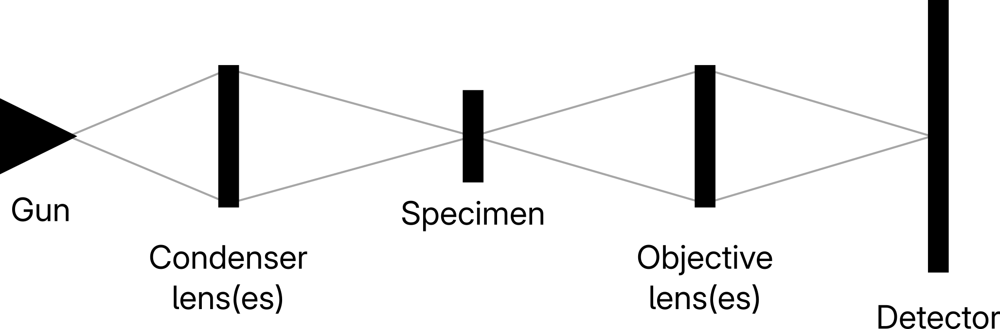

 

---

### (S)TEM Geometry: Image plane

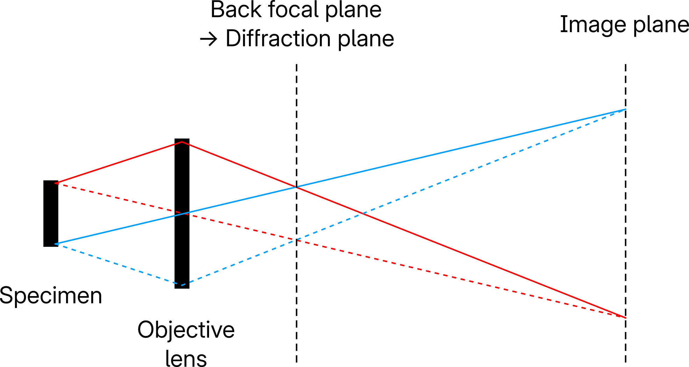

 

The wave at the image plane is (ideally) identical to the exit wave of the specimen

---

### (S)TEM Geometry: Diffraction plane

 

Back focal plane = Image plane of infinity

-> Fraunhofer (far-field) diffraction = Fourier transform = Reciprocal space!

---

### (S)TEM Geometry: Parallel illumination

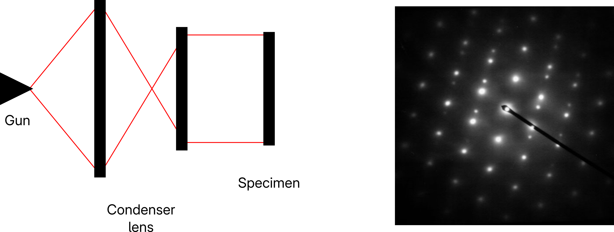

 

Parallel beams create spot patterns -> Selected Area Diffraction Pattern (SADP)

<!-- _footer: Zone Axis Diffraciton Pattern of Twinned Austenite in Steel. From https://commons.wikimedia.org/wiki/File:Austenite_ZADP.jpg.
 -->

---

### (S)TEM Geometry: Convergent beam illumination

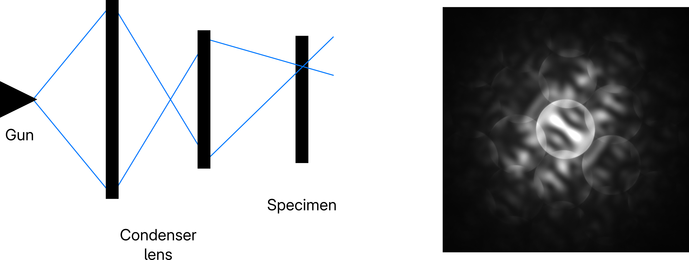

 

Aperture decides convergence angle ($\alpha$)

Convergent beams create "Bragg discs" -> Convergent Beam Electron Diffraction (CBED)

<!-- _footer: CBED pattern of GaN/InGaN. From https://www.gatan.com/resources/media-library/110-cbed-pattern-ganingan-0?modal=1 -->

---

### Ewald sphere

Diffraction pattern -> Intersection of Ewald sphere and reciprocal lattice

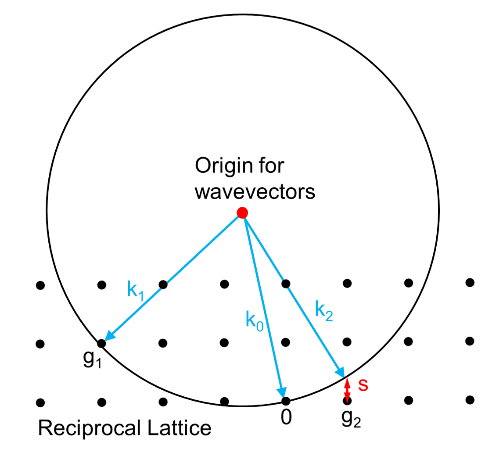

<!-- _footer: https://commons.wikimedia.org/wiki/File:Ewald3.png -->

---

### Ewald sphere

Thin sample in $z$ direction -> Projection of reciprocal lattice, "relrods"

$$\psi(x, y) \cdot \delta(z) \quad \leftrightarrow \quad \Psi(k_x, k_y) \cdot 1 $$

---

### Laue Zones

Laue zones (LZ): diffraction planes perpendicular to the incident beam

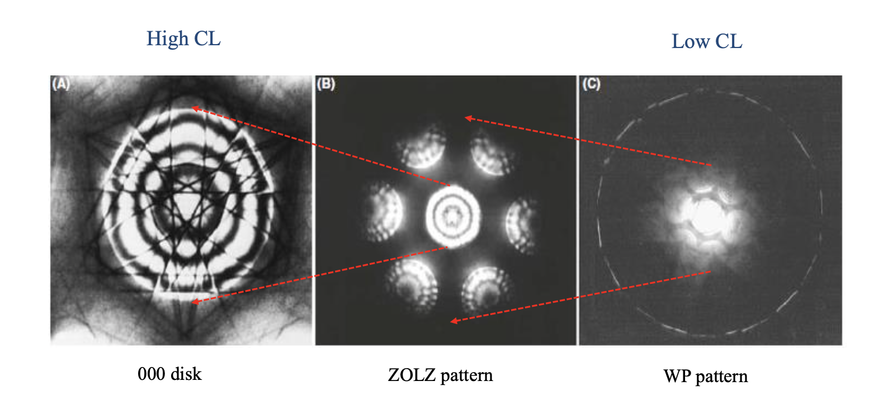

Convergent beam rotates the Ewald sphere -> We can find Higher-Order LZ (HOLZ) in CBED!

---

### What is an exit wave?

Some function of incident beam (illumination) $\psi_\text{in}$ and the sample potential $V$

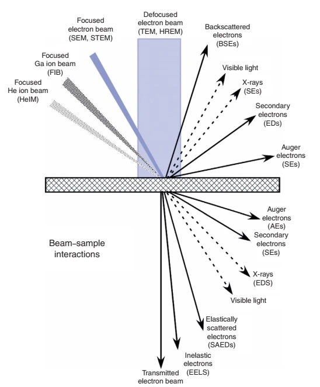

<!-- _footer: https://vaccoat.com/blog/transmission-electron-microscopy-tem/ -->

---

### Projection approximation

$$\psi_\text{exit}(\mathbf{x}) = \psi_\text{in}(\mathbf{x}) \cdot e^{i\sigma V(\mathbf{x})}$$

 

cf)

$\psi \sim e^{i S / \hbar}$

$\Delta \phi = (1 / \hbar) \int (eV - e \mathbf{v} \cdot \mathbf{A}) dt$

---

### Thicker specimens have dynaimcal scattering

Strongly interacting or thicker samples scatter electrons more than once.

- Diffracted beams couple to one another

- Intensity depends strongly on thickness and orientation

- A focused probe can channel along atomic columns

 

Modelling interactions:

- Bloch-wave eigenstate method

- Multislice approximation

---

### Why do we need lenses? -> Phase problem

In a perfect world, we completely know the linear propagation operator $\mathcal{P}$

$$\psi_\text{screen} = \mathcal{P}[\psi_\text{exit}]$$

Still, we can only measure the intensity of the electron wave:

$$ I = |\psi_\text{screen}|^2 $$

We need the objective lens(es) to focus back to an real-space image

---

### Exit wave -> Detector

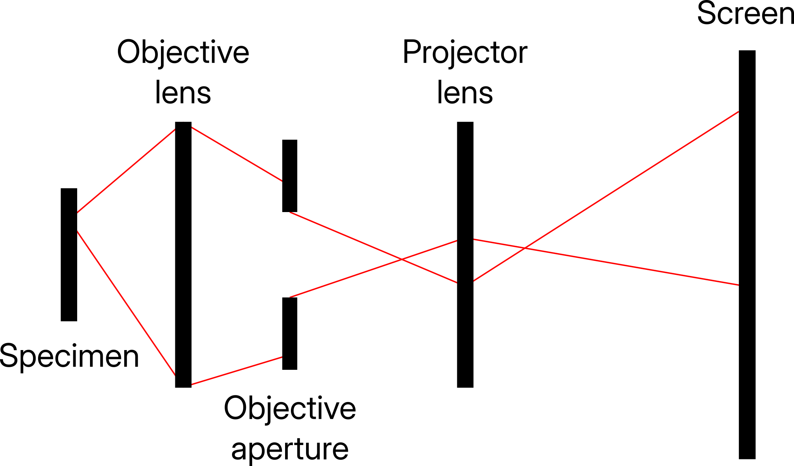

---

### TEM imaging

The conventional imaging method

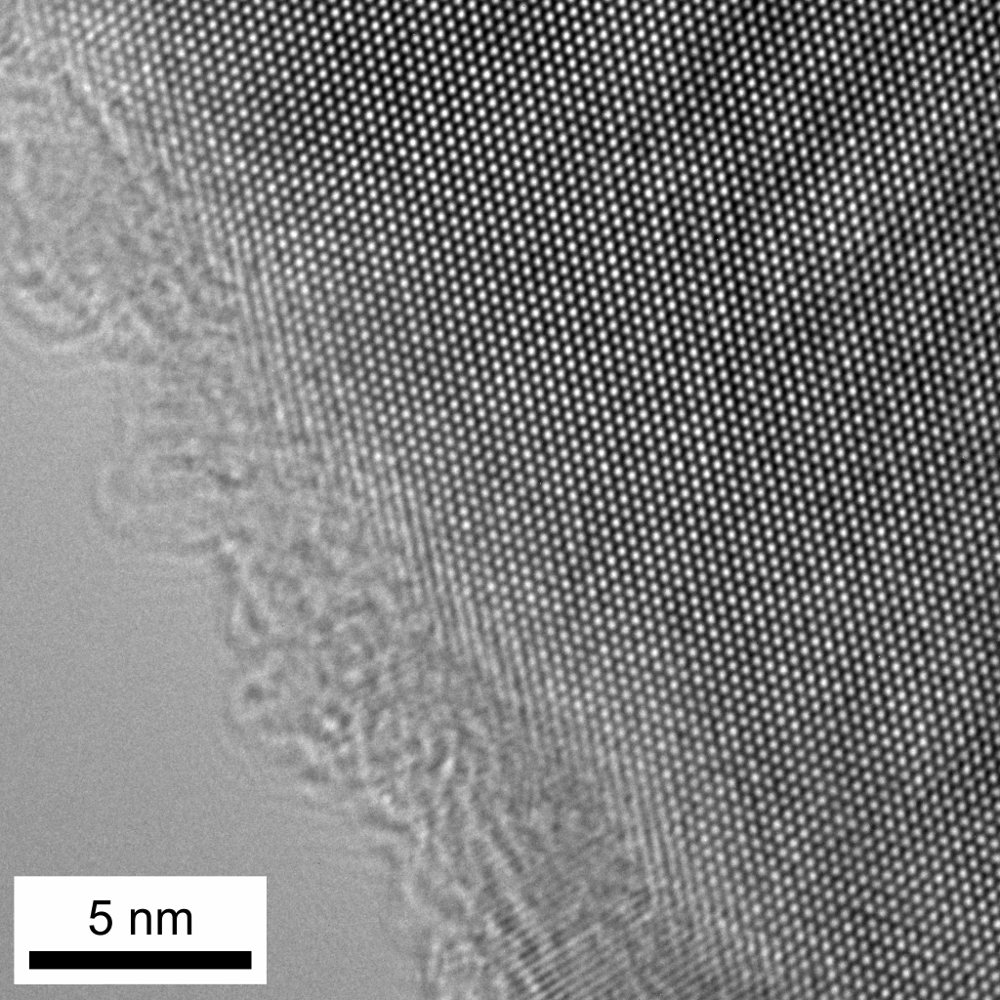

<!-- _footer:  HRTEM image of magnesium. From https://commons.wikimedia.org/wiki/File:HrtemMg.png -->

---

### Contrast Transfer Function, Point Transfer Function

Lenses also have their own transfer functions:

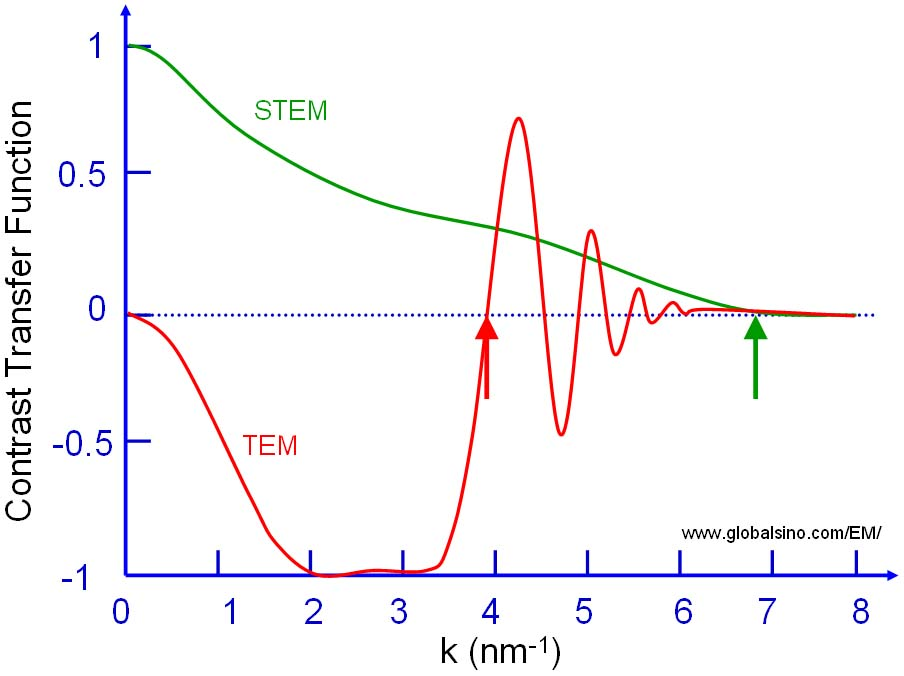

---

### STEM imaging

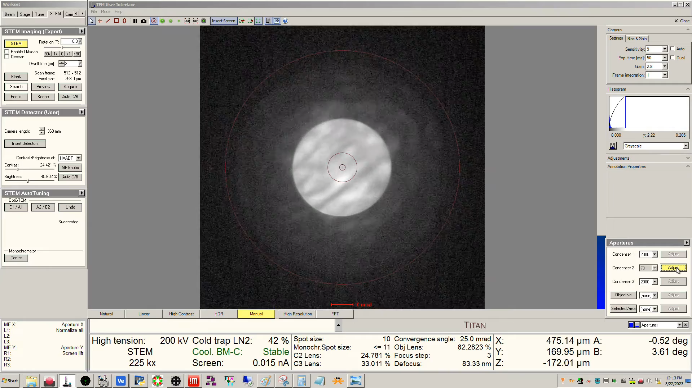 &nbsp;&nbsp;&nbsp;&nbsp;&nbsp;&nbsp; 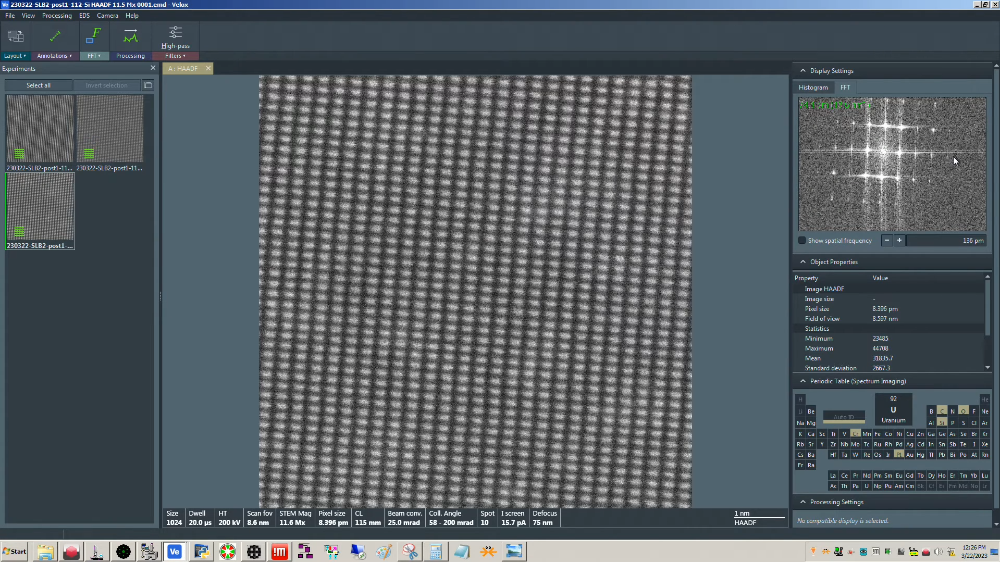

1 pixel per probe position -> 2 displays: 1 for beam and 1 for scanned "image"

Screen does not contain image! Instead it contains rich information of specific probe position

Conventional STEM : Brightness of pixel = # of electrons hitting detector

---

### Detecting parts of the CBED

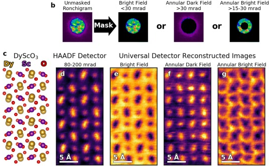

<!-- _footer: Hachtel et al. (2018). https://doi.org/10.1186/s40679-018-0059-4
 -->

---

### Pixelated detectors: 4D-STEM

Specimen plane (~ real space) probe positions $\{R_x, R_y\}$

$\otimes$

Detector plane (~ reciprocal space) pixel positions $\{k_x, k_y\}$

-> 4-dimensional array

---

### Roadmap

- TEM

    - 4D-STEM

        - Ophus, Four-Dimensional Scanning Transmission Electron Microscopy (4D-STEM): From Scanning Nanodiffraction to Ptychography and Beyond (2018)
        https://doi.org/10.1017/S1431927619000497

    - Ptychography

- Materials / PLD

    - Sheplin et al., A practical guide to pulsed laser deposition (2023)
    https://doi.org/10.1039/d2cs00938b

    - Eason, Pulsed Laser Deposition of Thin Films (2006)