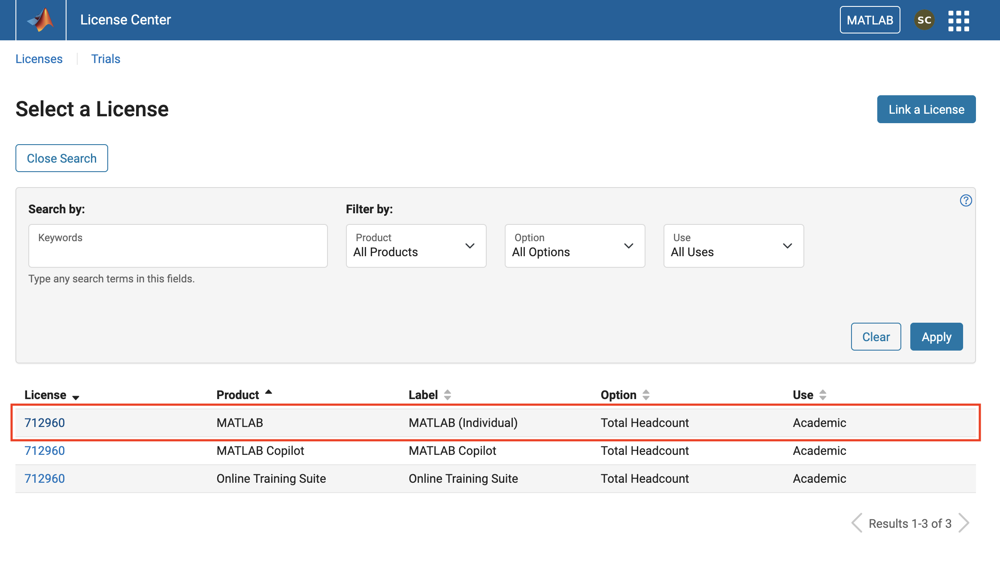
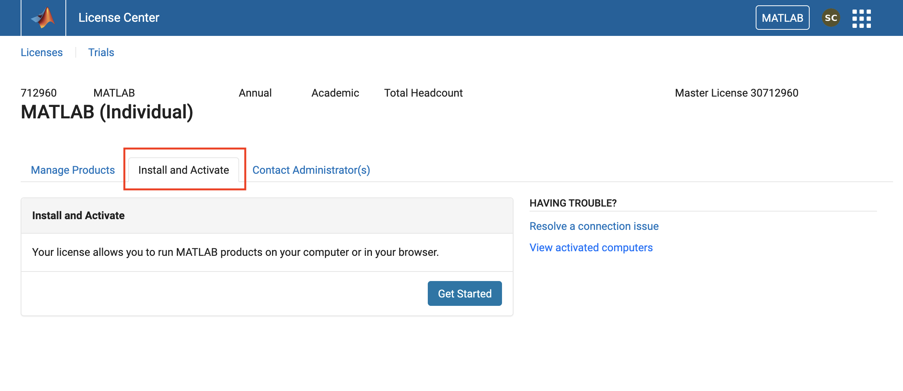
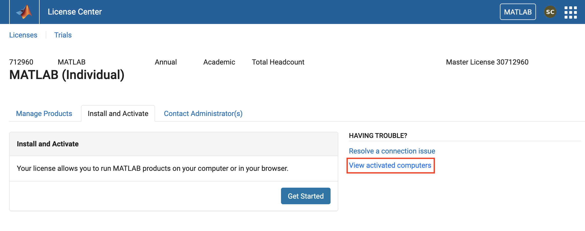
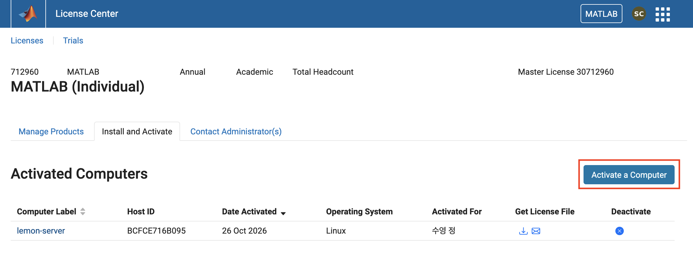
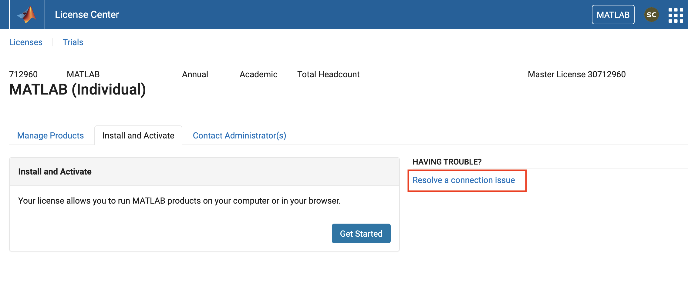
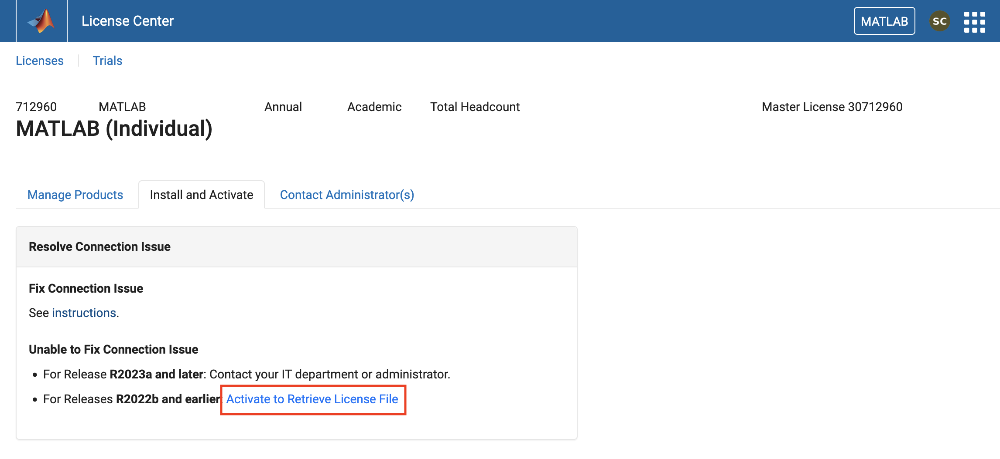
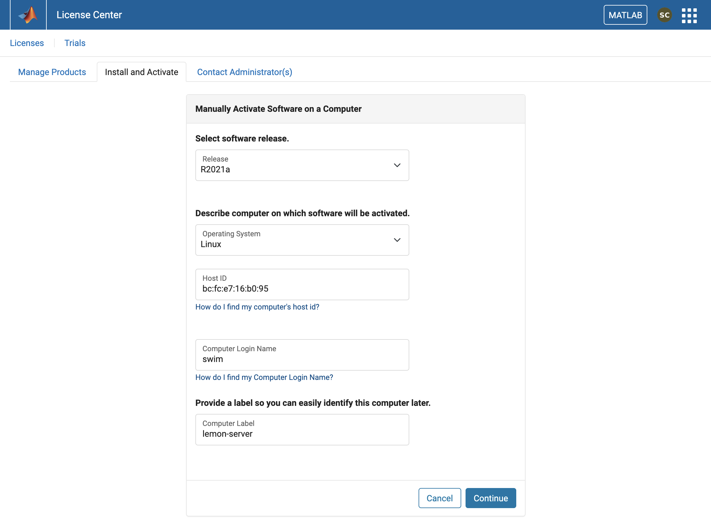
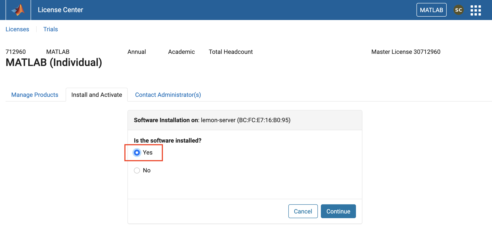
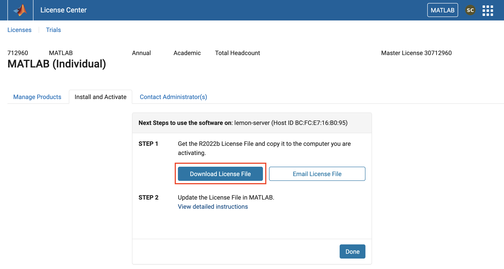

<!-- _class: title -->
<!-- _paginate: false -->
<!-- _footer: "" -->

# MATLAB Individual License for server usage

Last updated 2026.10.27

---

## 1. 라이선스 파일 받기

https://www.mathworks.com/licensecenter/licenses 에서 MATLAB (Individual) 선택

<br/>



---

## 1. 라이선스 파일 받기

Install and Activate 탭 선택 

<br/>



---

## 1. 라이선스 파일 받기

오른쪽에 View activated computers 선택

<br/>




- View activated computers 링크가 없으면 6~7쪽 **처음 활성화시키는 경우** 참고

---

## 1. 라이선스 파일 받기

Activate a Computer 선택

<br/>



- 6~7쪽 **처음 활성화시키는 경우** 건너뛰기

---

## 처음 활성화시키는 경우:

오른쪽에 Resolve a connection issue 선택

<br/>



---

## 처음 활성화시키는 경우:

Activate to Retrieve License File 선택

<br/>



---

## 1. 라이선스 파일 받기

내용 기입 

(2026.10.27 기준)

Release: R2021a

Operating system: Linux

Host ID: BC:FC:E7:16:B0:95

Computer Login Name: 서버 아이디

Computer Label: 마음대로



---

## 1. 라이선스 파일 받기

Yes 선택

<br/>



---

## 1. 라이선스 파일 받기

Download License File 선택 &rarr; `license.lic` 파일 저장됨

<br/>



---

## 2. 라이선스 파일 업데이트

1.  서버에 본인의 `licence.lic` 파일 저장

    > 경로가 정해져 있는 건 아니지만 `/home/<username>/license.lic` 혹은 `/home/<username>/matlab/license.lic`처럼 기억하기 쉬운 곳에 두는 것을 추천

<br/>

2.  본인의 `/home/<username>/.bashrc` 파일에서 다음 줄 편집하고 저장 (보통 `.bashrc` 파일 맨 위에 있음)

    ```
    export MLM_LICENSE_FILE=...
    ```
    &darr;
    ```
    export MLM_LICENSE_FILE=/home/<username>/license.lic
    ````

---

## 2. 라이선스 파일 업데이트

3. 터미널에서 `.bashrc` 변경사항 적용
    
    ```bash
    $ source .bashrc
    ```