<!-- _class: title -->
<!-- _paginate: false -->
<!-- _footer: "" -->

# LEMON Open lab

2026.11.06

---

## Contents

0. Lab + PLD 투어

1. TEM 소개

2. 현재 연구 소개

---

## (Scanning) Transmission Electron Microscopes

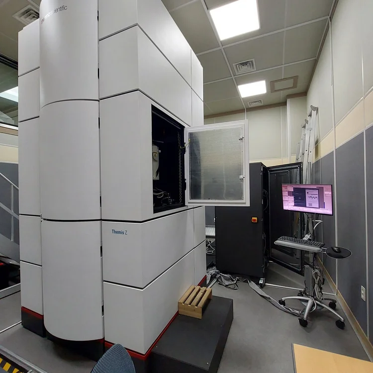

서울대학교 신소재공동연구소 Themis-Z, ...

---

## (Scanning) Transmission Electron Microscopes

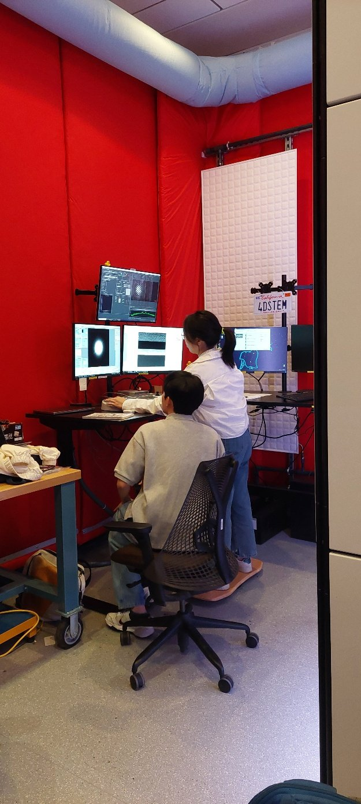

Cornell Spectra 300, ...

---

## Transmission Electron Microscopy

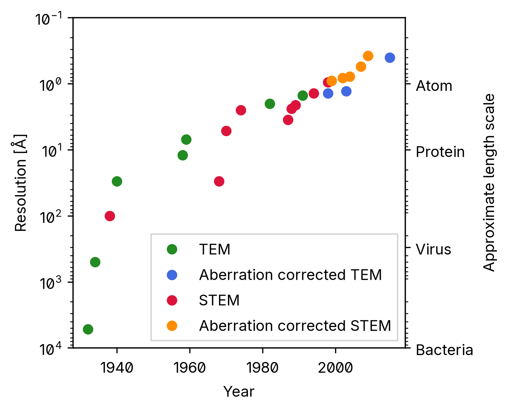

Atomic resolution microscopy: 1~0.1 Å

---

## Conventional TEM (CTEM)

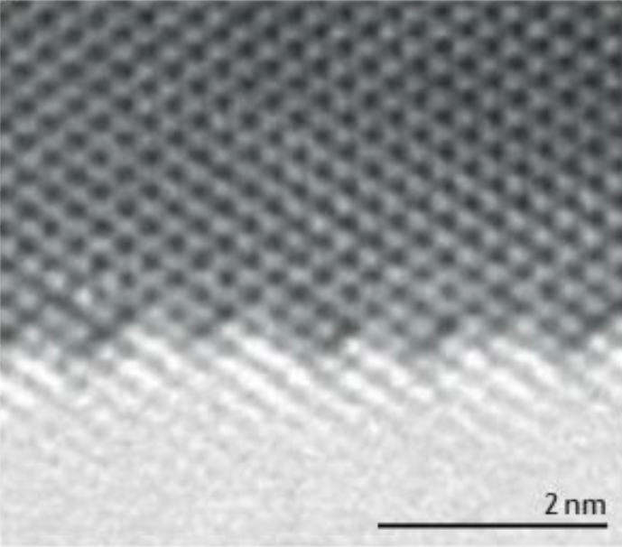

---

## Cs-Corrected CTEM

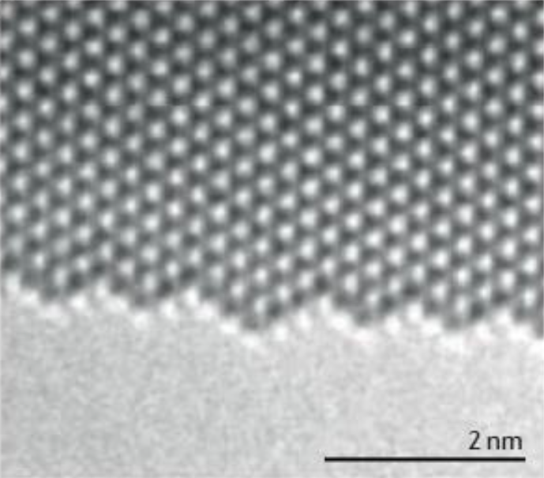

---

## Scanning TEM (STEM)

- 수차, 시편 두께, 초점 거리 등에 덜 민감 &rarr; 고해상도 이미지
- Z-contrast, strain, chemical analysis 등 새로운 분석

 

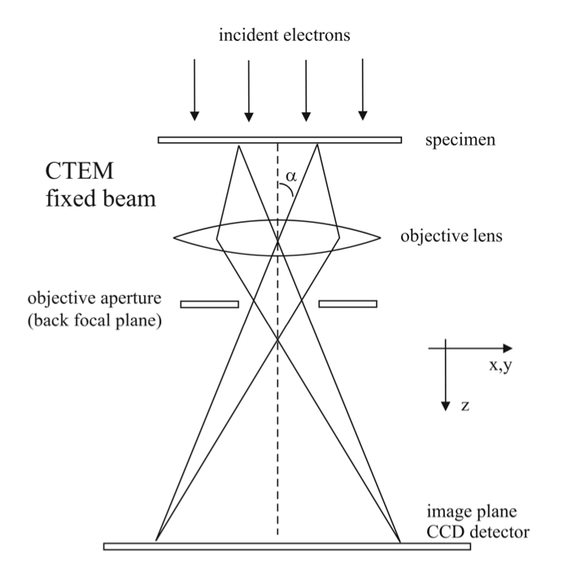 &larr; CTEM &emsp;&emsp;&emsp; 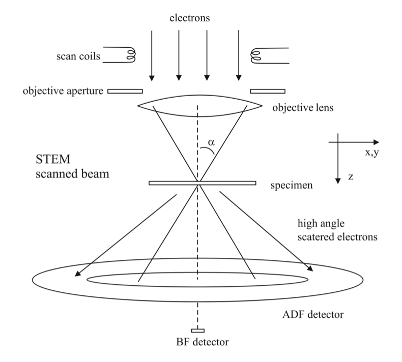 &larr; STEM

---

## Cs-Corrected STEM

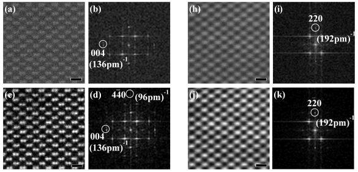

---

## 4D-STEM

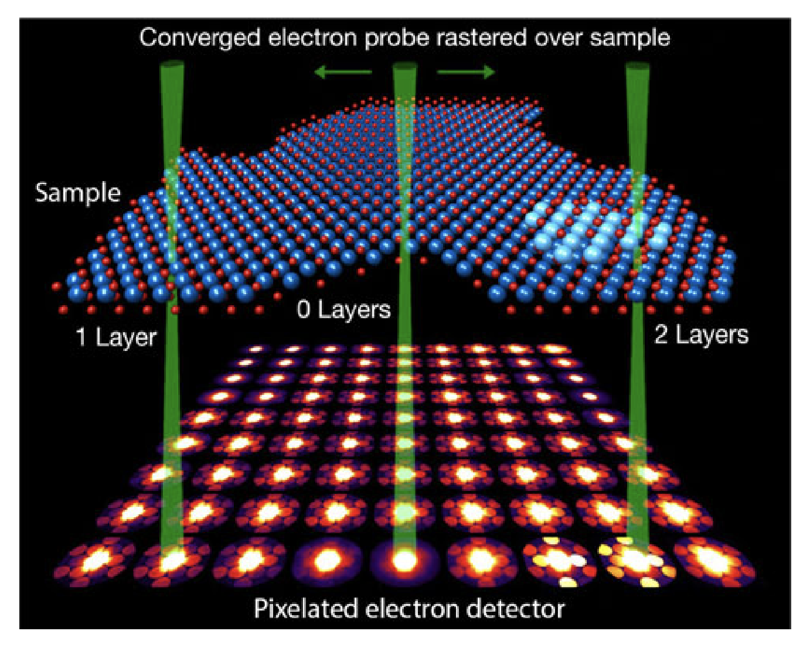

---

## 4D-STEM

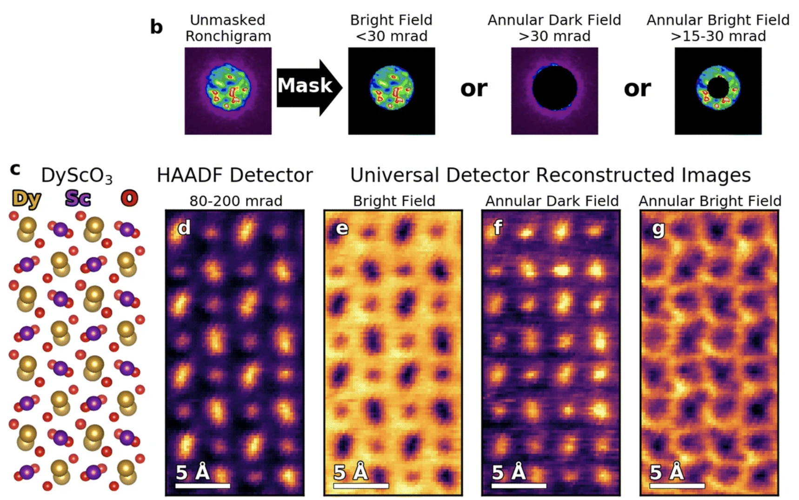

---

## Ptychography

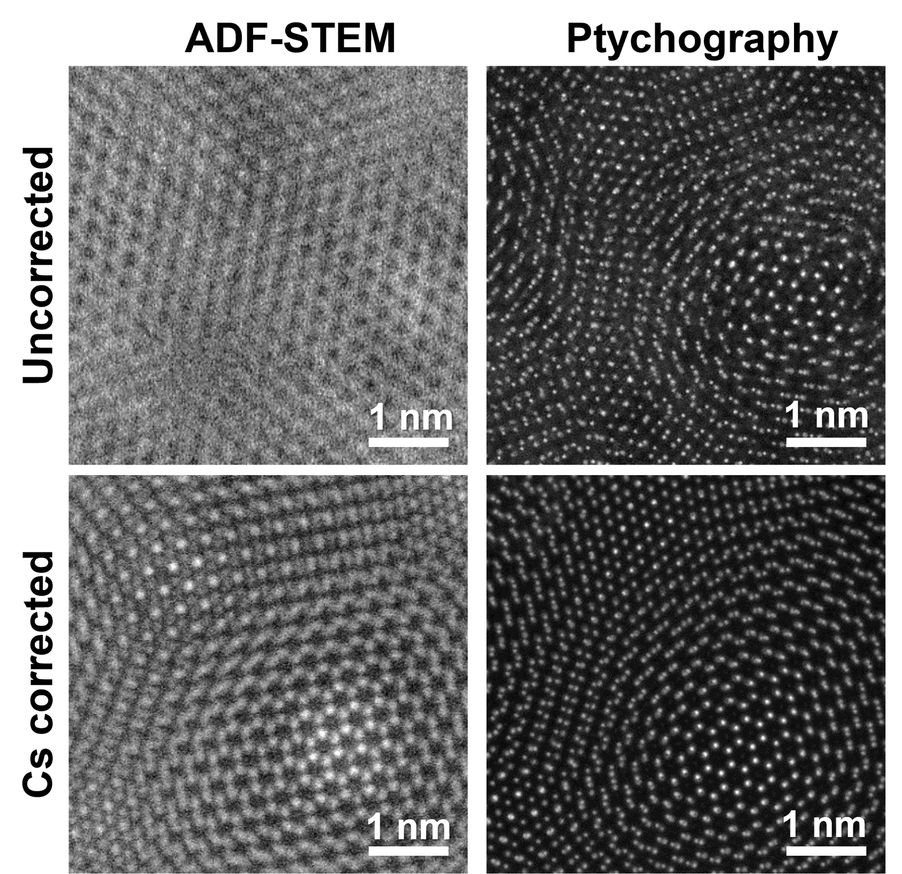

---

## Examples

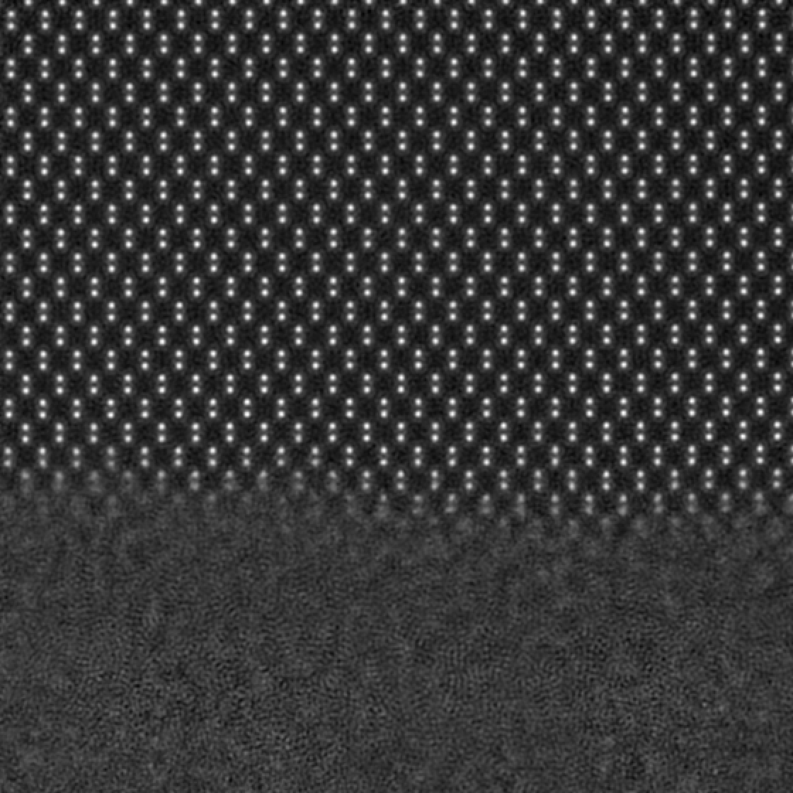

Depth-resolved 3D Ptychographic imaging of FIB-damaged Silicon

---

## Examples

BaTiO3 dislocation analysis using 3D ptychography

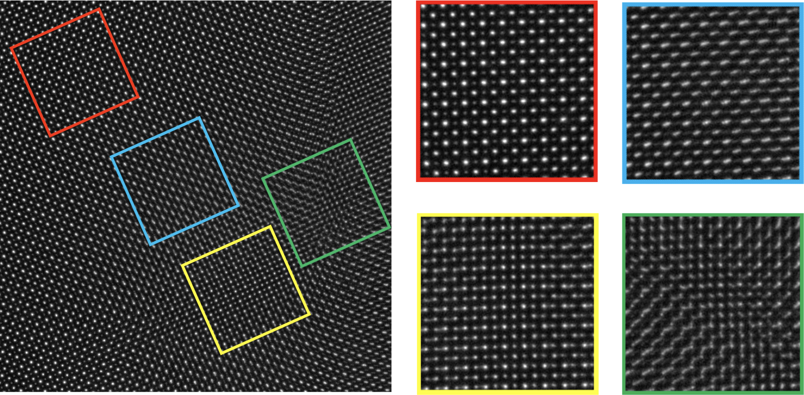

---

## Examples

4D-STEM crystallographic phase mapping of SrHfO3

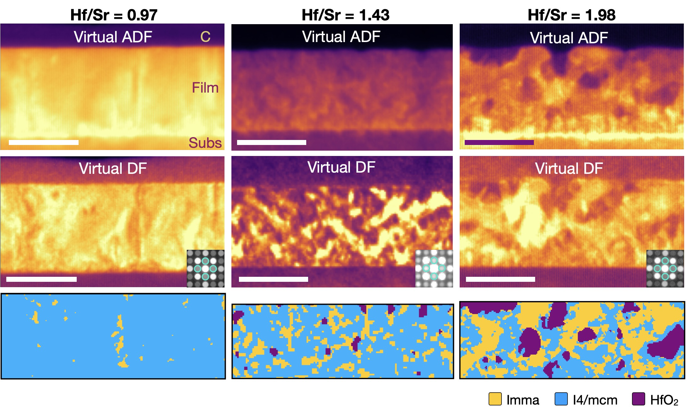

---

## Examples

HAADF-STEM and EDS imaging of SrTiO3 interface

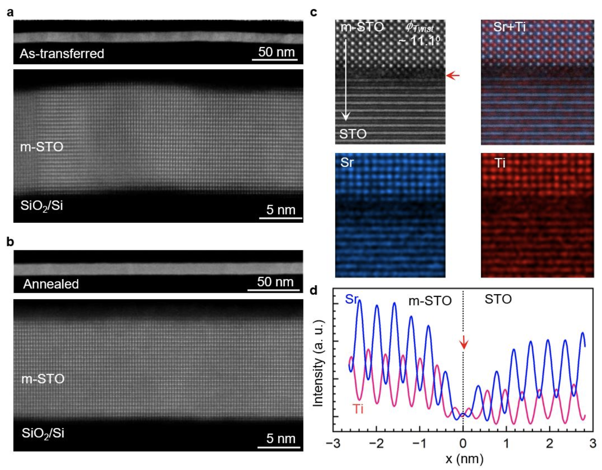

---

## Examples

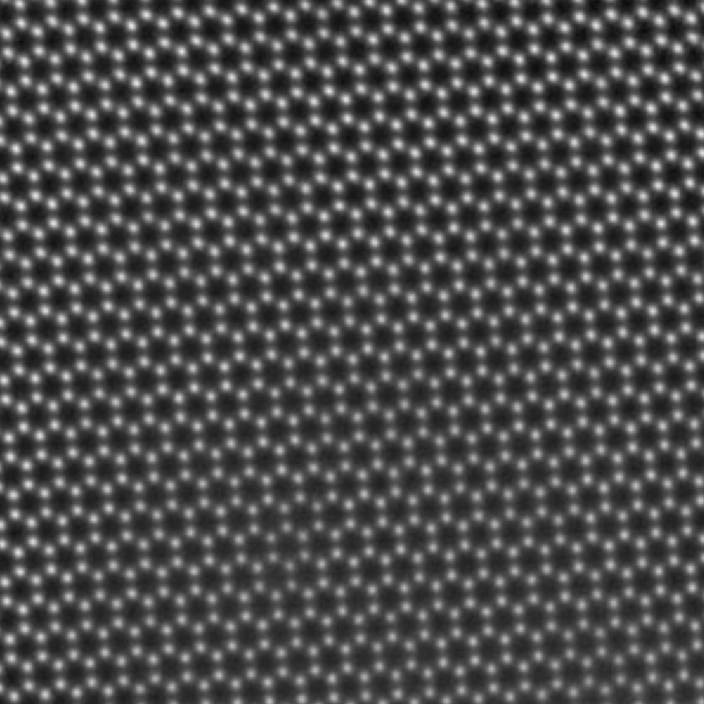

3D Ptychography of hBN using Themis-Z

---

## Active topics

- Phase coexistance in high-&kappa; materials

- Properties of high band gap oxides

- Chemical + structural analysis of oxides

- Ptychographic imaging of semiconductor heterostructure

- Ptychography algorithm improvements

- Device fabrication using perovskite oxide thin films, including FeFETs

- Strain engineering to develop novel ferroelectric perovskite oxides

- Freestanding membrane fabrication and transfer

---

<!-- _class: title -->

# Q & A

